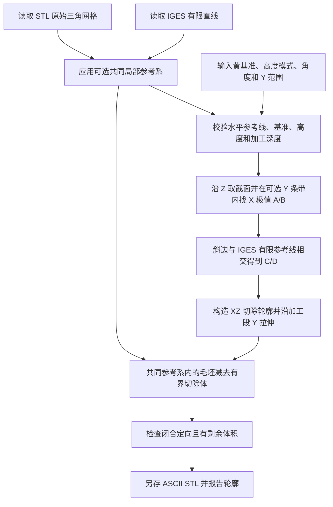

# 配对 STL / IGES 合成加工示例

本例在给定 Y 范围内，从原始毛坯切出沿深度延伸的梯形轮廓。保留侧、加工深度和黄基准的输入方式均为合成样件约定。客户件的规则和公差仍待验证。

## 输入与支持范围

| 输入 | 约束 |
|---|---|
| `--stl` | ASCII 或二进制 STL。加工支持单一封闭、外向定向且体积为正的三角网格，包括斜面和沿 Y 变化的截面。相邻三角形必须共享完全相同的顶点坐标。自交、破面与多壳体超出支持范围，程序不尝试修复，也不保证诊断所有自交。 |
| `--igs` | IGES 文本，毫米、模型比例 1，恰好一个无变换的 110 型直线实体。参考线两端同 Y、Z，沿 X。两条梯形斜边都须与该有限线段相交，允许交点位于内部或端点。端点比较采用 `0.000001 mm` 浮点容差。 |
| 坐标 | 两份文件应对齐到同一右手毫米坐标系。+X 向右，Y 为深度轴，+Z 向上。也可通过 `--frame` 给两者同变换；输出保留局部坐标，不自动还原世界系。 |
| `--yellow-z` | 显式输入水平黄基准的局部 Z。 |
| 高度 | `--offset` 为黄基准至 A/B 截面高度；互斥选项 `--igs-vertical-gap` 为截面至水平 IGES 线的正 Z 向距离。不是通用三维最短距离。 |
| A/B 取点 | 默认全截面 X 极值。`--ab-y-range MIN MAX` 显式把候选点限制在 Y 条带内，不假设该条带就是脸部，也不自动消除多轮廓歧义。 |
| 深度 | `--y-start < --y-end`，两者严格位于毛坯 Y 范围内，且区间包含 IGES 参考线的 Y。 |
| `--out` | 另存 ASCII STL。路径已存在时命令失败，不覆盖原文件。 |

## 算法流程图



在加工段中，保留实际毛坯里 `AB` 高度以下的材料，以及 `ABDC` 梯形内的材料。由切除轮廓拉伸得到有界切除体，使用 Manifold 布尔差直接作用于原始毛坯。范围外保留原始几何，三角剖分可能因布尔运算调整。截面重合三角面或边时，沿用预览报错规则。圆曲面只能以 STL 三角网格近似表示。程序输出几何成品，不生成设备刀路。

## 配对文件与独立调参

在独立项目根目录运行。加工依赖安装到临时虚拟环境，预览仍可直接使用基础 Python。

```bash
machining_demo_dir=$(mktemp -d)
python3 -m venv "$machining_demo_dir/venv"
mesh_python="$machining_demo_dir/venv/bin/python"
"$mesh_python" -m pip install -r requirements.txt

run_sloped_demo() {
  result_name=$1
  shift
  "$mesh_python" -B machine.py \
    --stl examples/sloped-stock.stl \
    --igs examples/wide-reference.igs \
    --yellow-z 0 --y-start 4 --y-end 16 \
    --out "$machining_demo_dir/$result_name.stl" "$@"
}
run_sloped_demo sloped-default
run_sloped_demo sloped-angle-55 --angle 55
run_sloped_demo sloped-offset-5 --offset 5
"$mesh_python" -B -m unittest discover -s . -v
```

斜面毛坯样件宽 `30 mm`、深 `20 mm`，顶面为 `z = 20 + 0.2y`。固定参考线从 `(-15,10,14)` 到 `(15,10,14)`，支持默认 `7.5 mm / 53°` 和偏移 `5–10 mm`、角度 `52–55°`。`z_base = yellow_z + offset`，每侧水平内收 `(14 - z_base) / tan(angle)`。角度或偏移可单独改变，前提是交点仍在线段内且梯形有效。基准以下、深度范围外和斜面下方的保留物料可通过回读 STL 检查。

原盒体配对仍可复现，给定参数成品体积为 `6900 mm³`。

```bash
"$mesh_python" -B machine.py \
  --stl examples/box-binary.stl \
  --igs examples/box-edge.igs \
  --yellow-z 0 --offset 5 --angle 45 --y-start 4 --y-end 16 \
  --out "$machining_demo_dir/box-machined.stl"
```
